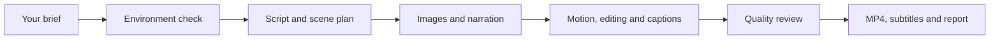

<div align="center">

# AI Video Skills

### From a short brief to a structured video production workflow.

**Nine reusable skills · Portable production engine · Arabic narration and captions**

[Get started](#quick-start) · [See examples](#what-can-you-create) · [Install skills](#use-with-your-agent) · [Documentation](#documentation) · [العربية](README.ar.md)

**v0.1.0** · Node.js 22+ · Apache-2.0

</div>

---

AI Video Skills gives your AI agent a reusable process for writing a script, preparing images and narration, animating stills, editing scenes, checking quality and delivering an MP4. The included local engine handles the repeatable production work and saves checkpoints so interrupted renders can resume.

Built for **Codex, Claude Code and Google Antigravity**, with optional adapters for **Remotion, FFmpeg, Whisper, VoiceTuT, Concat and image generation**. Use your existing images and recordings, or connect approved providers when you need new assets.

> **Current evidence:** 35 tests passed on Windows; actual FFmpeg and Remotion renders/resume were verified. Linux/macOS CI and agent installation layouts are prepared; native host discovery and all live generation providers have not been fully verified. [Read the verification record →](docs/VERIFICATION.md)

## What can you create?

These are **example briefs and intended deliverables**, not claims that the finished films below have already been produced. Real imagery, narration and transcription require supplied assets or configured providers.

### 1. A narrated Arabic documentary

**Ask your agent:**

> Create a 60-second documentary about deep-ocean life in Egyptian Arabic. Use a vertical 1080×1920 layout, restrained camera motion and Arabic subtitles. Check available tools first and ask before installing anything.

**Production plan:** a sourced script → scene images → recorded/generated narration → measured timings → camera motion → captions → reviewed export.

**Expected delivery:** a 60-second vertical `final.mp4`, a subtitle sidecar, an asset provenance list and a production report. If no voice or image provider is available, the agent asks for assets or an approved setup before continuing.

### 2. A product showcase from your own photos

**Ask your agent:**

> Turn these three product photos into a 20-second square showcase. Use gentle pans and zooms, short Arabic captions and my supplied music. No narration. Keep the product fully visible.

**Production plan:** review the supplied photos → choose safe crops → time the scenes/captions → animate → mix the supplied music → inspect the export.

**Expected delivery:** a 1080×1080 H.264/AAC video with timed captions. Supplied assets allow this workflow to use FFmpeg without installing image or voice generators. The supplied music must be authorized for your use.

### 3. An educational explainer with an existing recording

**Ask your agent:**

> Build a 90-second landscape explainer from this Arabic recording and these illustrations. Keep the recording intact, create readable captions and give me the MP4 plus SRT. Use Whisper only if it is already configured; otherwise help me prepare manual cues.

**Production plan:** measure the recording → split it into scene audio where needed → align illustrations → transcribe or use manual cues → correct the text/timing → render and review.

**Expected delivery:** a 1920×1080 video, corrected `captions.srt` and a resumable project. Narration that exceeds a scene is rejected so timing can be corrected explicitly.

## A real, verified output sample


*Frame from the actual 4-second FFmpeg smoke test: deterministic gradient imagery, animated camera, Arabic burnt-in captions and synthetic test tones/music mixing. This is an engineering fixture, not AI-generated photography or spoken narration.*

Recreate it locally:

```sh
node scripts/smoke.mjs
```

The clip is written to `work/smoke/output/final.mp4`. Its measured output was **640×360 · 24 FPS · H.264/AAC · approximately 4 seconds**. A second render reused both saved scenes. A separate synthetic five-minute timeline also rendered and resumed successfully; it does not establish high-resolution documentary performance.

## Quick start

### Requirements

| Requirement | Used for |
| --- | --- |
| Node.js 22+ | CLI, project validation and orchestration |
| FFmpeg + FFprobe | Rendering, audio assembly and media checks |
| FFmpeg with libass + an Arabic-capable font | Arabic burnt-in captions |
| Optional providers | New images, speech, ASR, Remotion rendering or Concat handoff |

The core uses Node built-ins; **no `npm install` is required**. Models, browsers and external services are not bundled.

From the repository directory:

```sh
# Check the environment without installing anything.
node cli/aiv.mjs doctor

# Render the included 4-second color-card demo.
node cli/aiv.mjs render examples/demo/project.json --out work/demo

# Inspect the exported media.
node cli/aiv.mjs inspect work/demo/final.mp4

# Verify and reuse completed scenes.
node cli/aiv.mjs resume examples/demo/project.json --out work/demo
```

The included color-card demo intentionally has no narration. For motion, caption and audio-mixing checks, use the smoke test above.

### Understand the environment result

| Status | Meaning | Next step |
| --- | --- | --- |
| `READY` | The diagnostic requirements passed | Prepare assets and validate the project |
| `DEGRADED` | Optional capabilities are unavailable/unverified | Continue with supplied assets where appropriate |
| `BLOCKED` | A core requirement is missing/incompatible | Review and approve the necessary setup |

If FFmpeg is missing, `node cli/aiv.mjs setup ffmpeg` shows the exact package-manager operation and asks you to type `INSTALL`. Noninteractive execution declines. Plans cover winget on Windows, Homebrew on macOS and apt on Debian/Ubuntu; other distributions need reviewed manual setup. Models and browsers always need separate approval.

## Use with your agent

Choose the command for your host and replace the example project path:

```sh
node scripts/install-skills.mjs --agent codex --project "path/to/video-project"
node scripts/install-skills.mjs --agent claude --project "path/to/video-project"
node scripts/install-skills.mjs --agent antigravity --project "path/to/video-project"
```

For an explicitly requested personal installation across projects:

```sh
node scripts/install-skills.mjs --agent codex --user
```

Use `claude` or `antigravity` instead when appropriate. The installer refuses existing skill folders rather than overwriting them. Current Codex and Antigravity share `.agents/skills` in a project; install once if both use that same directory. Claude Code uses `.claude/skills`. [All current/legacy locations →](docs/COMPATIBILITY.md)

Refresh the host's skill inventory after installation. Keep this repository in place; if moved, reinstall or set `AIV_HOME`. Complete skill folders include launchers and references, so copying only `SKILL.md` is insufficient. Unpacking the repository does not install skills automatically.

## How production works



The **skills** guide the host agent's decisions and handoffs. The **engine** validates the scene plan, renders files and tracks progress. The **adapters** connect explicitly configured tools. Writing/research is performed by the host agent; the package does not bundle its own writing model.

| Skill | What it handles |
| --- | --- |
| [ai-video-producer](skills/ai-video-producer/SKILL.md) | Full workflow and production handoffs |
| [environment-doctor](skills/environment-doctor/SKILL.md) | Requirements, alternatives and setup approval |
| [script-writer](skills/script-writer/SKILL.md) | Narration, sources and scene breakdown |
| [image-director](skills/image-director/SKILL.md) | Visual direction, images and provenance |
| [voice-director](skills/voice-director/SKILL.md) | Speech, pronunciation and caption timing |
| [camera-animator](skills/camera-animator/SKILL.md) | Pans, zooms and safe framing |
| [video-editor](skills/video-editor/SKILL.md) | Timeline, music, captions and resumable rendering |
| [quality-inspector](skills/quality-inspector/SKILL.md) | Technical, visual, listening and temporal checks |
| [export-manager](skills/export-manager/SKILL.md) | Verified local delivery and authorized packaging |

## Build a project from your own assets

1. Create a project: `node cli/aiv.mjs init my-video/project.json`.
2. Replace its demo cards with project-relative image paths and add real narration files when needed.
3. Supply corrected subtitle cues; configure providers only for missing capabilities.
4. Validate, render and inspect:

```sh
node cli/aiv.mjs validate my-video/project.json --assets
node cli/aiv.mjs render my-video/project.json --out work/my-video
node cli/aiv.mjs inspect work/my-video/final.mp4
```

For generated assets, copy `examples/providers.example.json` to a private `providers.local.json`, configure the providers you intend to use, then run:

```sh
node cli/aiv.mjs prepare my-video/project.json --config providers.local.json
```

`prepare` generates missing scene images/narration only through configured providers. Keep tokens in explicitly named environment variables. [Project format →](docs/PROJECT_FORMAT.md) · [Provider setup and contracts →](docs/PROVIDERS.md)

### What you receive

```text
work/my-video/
├── final.mp4                 # H.264 video + AAC audio
├── captions.srt              # Subtitle sidecar
├── captions.ass              # Caption styling for burn-in
├── production-report.json    # Result, media checks and reused/rendered counts
├── checkpoint.json           # Resumable scene state
└── scene-<id>-<hash>.mp4      # Verified scene cache
```

Caption modes: `sidecar`, `burn` or `none`. A local font can be paired with its internal `fontFamily`. The engine preserves logical Arabic Unicode order. Current motion supports bounded zoom/pan; transitions are cut or fade through black. True parallax, arbitrary 3D moves and overlapping crossfades are outside v0.1.

### Resume after an interruption

```sh
node cli/aiv.mjs resume my-video/project.json --out work/my-video
```

Use the same output directory. Scene content and artifact hashes are checked before reuse; changed inputs or corrupt files rebuild the affected scene. Keep inputs outside the output directory. A render lock blocks concurrent writes; confirm the old process is gone before removing a stale lock.

## Optional integrations

| Integration | Capability | Alternative |
| --- | --- | --- |
| FFmpeg/FFprobe | Baseline rendering, audio, export and inspection | Required for this runtime |
| Remotion | Optional scene renderer using an existing browser | FFmpeg scene rendering |
| Whisper | Local-model transcription to cue JSON | Corrected manual cues |
| VoiceTuT | Narration through its configured local job bridge | Supplied audio / reviewed command bridge |
| A1111 / image command bridge | Scene image generation | Supplied authorized images |
| Concat | Provider-neutral timeline handoff | Engine editing/export |

Concat interchange is not a claimed native project import. Native editing requires mapping against the host's actual MCP tools. Endpoint configuration is not proof of service/model readiness. [Integration details →](docs/PROVIDERS.md)

## Verification and current limits

```sh
node --test
node scripts/check-skills.mjs
node scripts/smoke.mjs
```

- **Executed:** 35 passing Windows tests, nine skill checks, FFmpeg/Remotion renders and resume, malformed-media rejection, cache recovery and a synthetic five-minute timeline.
- **Prepared:** Linux/macOS and Node22/24 CI; supported host installation folders and launchers.
- **Still needs live verification:** all three hosts' native discovery, actual VoiceTuT/Whisper/image-model quality, native Concat import and a full 5–20-minute AI documentary benchmark.

Review actual captions, motion and sound before delivery. Mock protocol tests and file metadata do not establish voice quality or audiovisual synchronization. [Full evidence and limits →](docs/VERIFICATION.md)

## Documentation

| Guide | Purpose |
| --- | --- |
| [Arabic README](README.ar.md) | Arabic overview, examples and commands |
| [Project format](docs/PROJECT_FORMAT.md) | Schema, timings, paths, audio and cache behavior |
| [Provider guide](docs/PROVIDERS.md) | Optional integrations and private configuration |
| [Dependency matrix](docs/DEPENDENCY_MATRIX.md) | Required tools, detection and fallbacks |
| [Agent compatibility](docs/COMPATIBILITY.md) | Installation locations and verification boundaries |
| [Architecture](docs/ARCHITECTURE.md) | Layers and implementation decisions |
| [Verification](docs/VERIFICATION.md) | Commands, actual results and unperformed checks |
| [Source/video audit](docs/SOURCE_AUDIT.md) | Original report review and media findings |
| [Handoff](HANDOFF.md) | Continuation instructions and remaining work |
| [Contributing](CONTRIBUTING.md) · [Security](SECURITY.md) | Development and private-data guidance |

## Release and publishing

The source is available in the public [AI-Video-Skills repository](https://github.com/Mohamed-El-Hofy/AI-Video-Skills). Version `0.1.0` is the initial implementation; verification limits remain listed above. GitHub Actions checks run on pushes and pull requests; no automatic package/release publishing is configured. Future releases and external uploads require explicit authorization. [Release checklist →](docs/RELEASE_CHECKLIST.md)

## License

New code, skill instructions, templates and original deterministic fixtures are licensed under **[Apache-2.0](LICENSE)**. Optional tools, model weights, fonts, music, voices and supplied/generated media retain their own terms. Review [NOTICE](NOTICE) and [third-party boundaries](THIRD_PARTY.md) before redistributing them.
